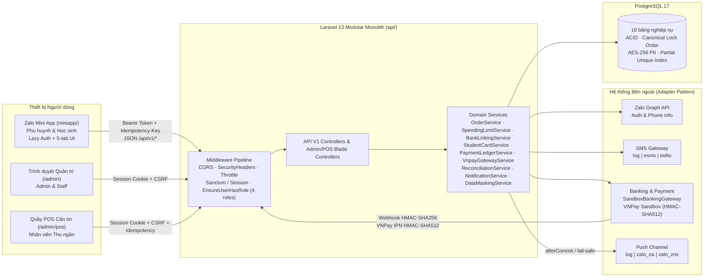
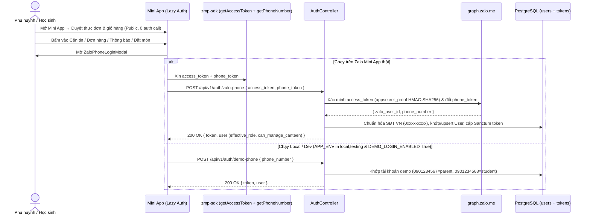
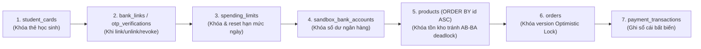
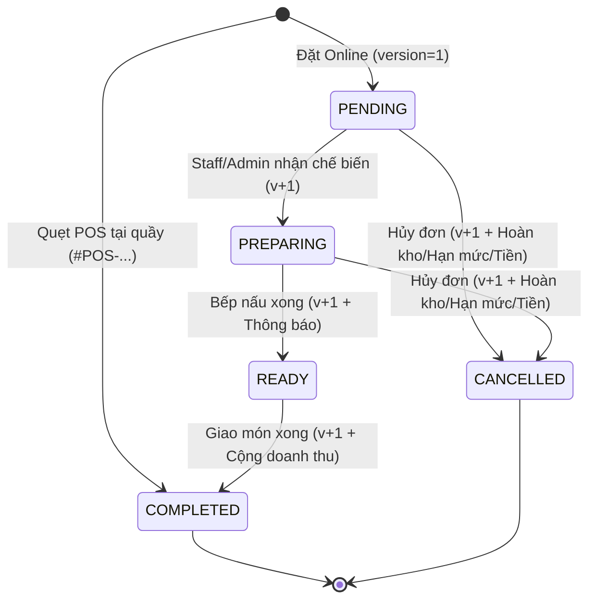

# Kiến trúc Hệ thống — Smart Canteen & Phân hệ Căn tin Số (`docs/architecture/system-architecture.md`)

## 1. Tổng quan Kiến trúc (High-Level Architecture)

Smart Canteen được tổ chức theo mô hình **Multi-Repository Modular Monolith** gồm 1 workspace điều phối (`TestPart2/` chứa tài liệu & kế hoạch) và **2 Git repository triển khai độc lập** (mỗi repo có `Dockerfile` multi-stage non-root, `compose.yaml`, `compose.prod.yaml` và GitHub Actions CI riêng):

1. **`miniapp/` (Zalo Mini App Frontend):** React 18 + TypeScript + ZaUI (`zmp-ui`) + `zmp-sdk` + Jotai (in-memory state) + TanStack Query v5 + Tailwind CSS.
2. **`api/` (Laravel 13 Backend API, Admin Portal & Staff POS):** PHP 8.4 + Laravel 13 đóng 3 vai trò trên cùng một tầng Domain Services dùng chung:
   - **REST API (`/api/v1/*`):** Xác thực Laravel Sanctum Bearer Token, phục vụ Mini App, Webhook Ngân hàng & VNPay IPN.
   - **Admin Portal (`/admin/*`):** Laravel Blade xác thực Session + CSRF, quản trị thực đơn/tồn kho, học sinh/thẻ, đối soát ngân hàng và nhật ký thông báo.
   - **Staff POS Terminal (`/admin/pos`):** Giao diện bán hàng 2 cột tại quầy căn tin kèm tra cứu thẻ, quẹt thẻ/tiền mặt và in biên lai nhiệt.
3. **PostgreSQL 17 (`titkul_canteen_demo` / `titkul_canteen_test`):** 18 bảng dữ liệu nghiệp vụ với giao dịch ACID, khóa dòng chống deadlock (`SELECT ... FOR UPDATE`), Partial Unique Index, và cột mã hóa AES-256.

---

## 2. Kiến trúc Xác thực Lazy Auth & Phân quyền 4 Vai trò (RBAC)

- **Quy tắc bảo vệ 4 vai trò:**
  - `admin`: Toàn quyền Web Admin + POS + API Admin.
  - `staff`: Quyền vận hành POS + điều phối đơn + xem (read-only) ở các màn hình nhạy cảm.
  - `parent` (và legacy `customer`): Toàn quyền tài chính cho các `students` có `user_id = auth.id`.
  - `student`: Chỉ xem & đặt món trên thẻ thuộc `students.student_user_id = auth.id`; mọi hành động tài chính phụ huynh bị chặn ngay ở Service & Controller với `403 PARENT_ROLE_REQUIRED`.

---

## 3. Thứ tự Khóa Dòng PostgreSQL Chuẩn (Canonical Lock Order — Chống Deadlock)

Mọi giao dịch tài chính và tồn kho (`createOrder`, `createPosPurchase`, `transitionStatus → CANCELLED`, `BankLinkingService`, `StudentCardService`, `SpendingLimitService`) đều tuân thủ nghiêm ngặt một thứ tự khóa dòng (`SELECT ... FOR UPDATE`) duy nhất:

> **Cơ chế Ghi Sổ cái Bền vững khi Lỗi Ngân hàng (`PaymentLedgerService`):**
> Khi `SandboxBankingGateway` báo lỗi (`INSUFFICIENT_BANK_BALANCE`, `BANK_DECLINED`, `GATEWAY_TIMEOUT`), toàn bộ `DB::transaction()` tạo đơn / trừ kho / trừ hạn mức được **rollback 100%** để bảo toàn số liệu; ngay trong khối `catch` **bên ngoài transaction**, `PaymentLedgerService` ghi một dòng bất biến (`FAILED` hoặc `TIMEOUT` kèm `gateway_txn_ref`) vào `payment_transactions` và `NotificationService` phát cảnh báo `PAYMENT_FAILED` cho phụ huynh.

---

## 4. Kiến trúc Thông báo Fail-Safe (`DB::afterCommit()` & Adapter Push)

- Mọi thông báo thành công (`PURCHASE_SUCCESS`, `LOW_SPENDING_LIMIT`, `ORDER_REFUNDED`, `ORDER_STATUS_UPDATED`, `BANK_LINK_CHANGED`, `SPENDING_LIMIT_UPDATED`) chỉ được gửi trong `DB::afterCommit(...)` → đảm bảo không bao giờ gửi thông báo "ma" cho giao dịch bị rollback (còn `PAYMENT_FAILED` được gửi ở khối `catch` ngoài rollback).
- `NotificationService::send()` luôn:
  1. Sanitize `action_url` qua `isSafeInternalRoute()` (chặn `https://`, `//`, `/\`, `javascript:`).
  2. Lọc đệ quy mọi khóa nhạy cảm (`account_number`, `national_id`, `phone_number`, `otp_code`, `password`, `token`, `secret`) khỏi `meta`.
  3. Lưu bản ghi In-App vào `canteen_notifications` trước, rồi mới gọi `PushNotificationChannelInterface` (`LogPushNotificationChannel` | `ZaloOaPushChannel` | `ZaloZnsPushChannel`) trong khối `try/catch` — lỗi từ Zalo API chỉ cập nhật `push_status = FAILED`, **tuyệt đối không làm gián đoạn luồng thanh toán hay POS**.

---

## 5. Máy trạng thái Đơn hàng, Thẻ học sinh & Liên kết Ngân hàng

- **Thẻ Học sinh (`StudentCardStatus`):** `ACTIVE ↔ LOCKED`, `ACTIVE / LOCKED → REVOKED` (thu hồi vĩnh viễn — tự động chuyển `bank_links` sang `UNLINKED` và hủy OTP đang mở).
- **Liên kết Ngân hàng (`BankLinkStatus`):** `PENDING_OTP → ACTIVE` (sau OTP hợp lệ), `PENDING_OTP → FAILED / EXPIRED`, `ACTIVE → UNLINKED` (sau OTP hủy `BANK_UNLINK` hoặc Admin thu hồi thẻ). Partial Unique Index PostgreSQL đảm bảo tối đa 1 dòng `ACTIVE` trên mỗi `student_card_id`.
