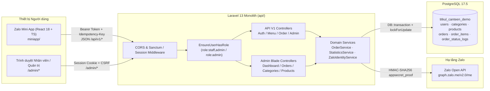
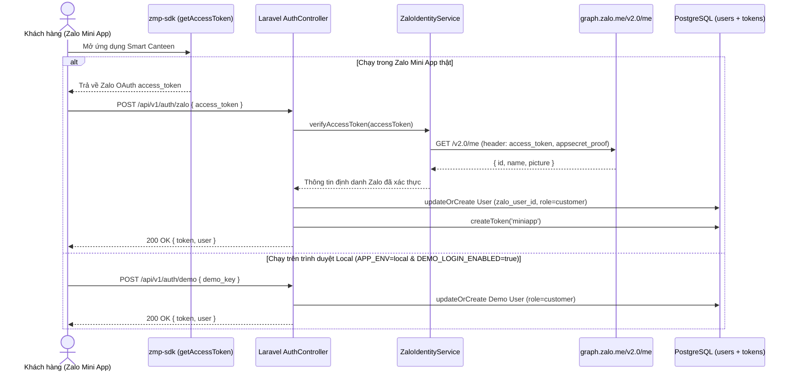
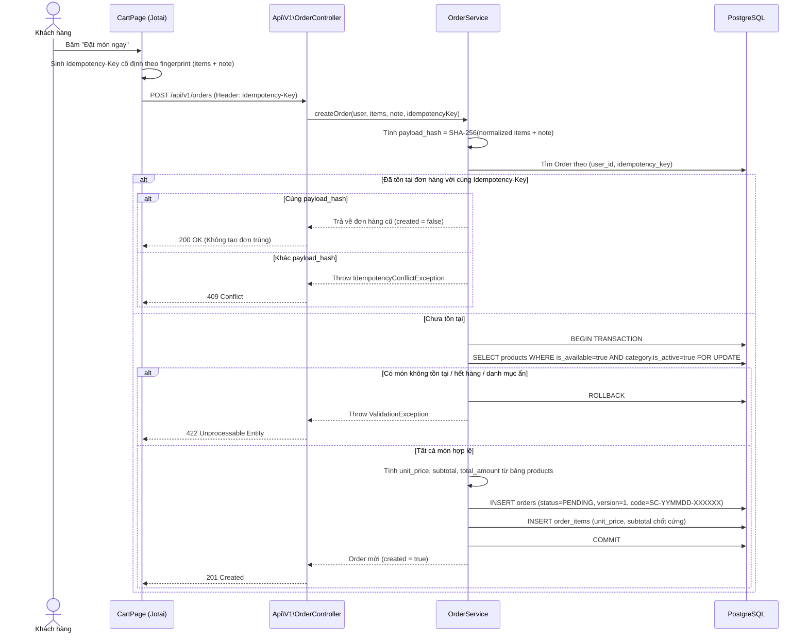
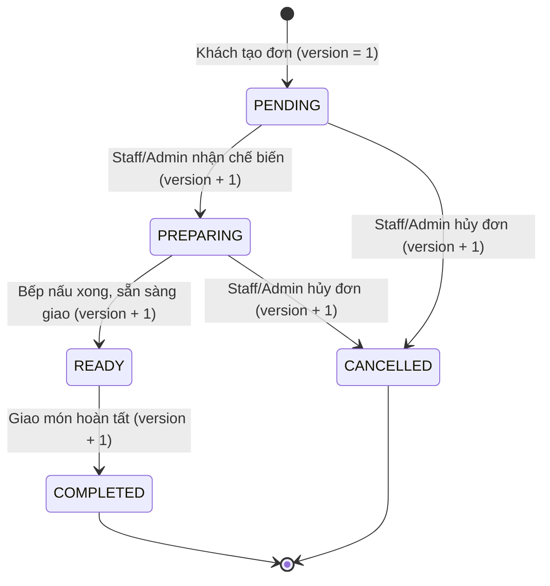

# Kiến trúc Hệ thống — Smart Canteen (`docs/architecture/system-architecture.md`)

## 1. Tổng quan Kiến trúc (High-Level Architecture)

Smart Canteen được thiết kế theo mô hình **Modular Monolith** đặt trong một **Monorepo** gồm hai ứng dụng độc lập giao tiếp qua giao thức RESTful JSON API (`/api/v1`):

1. **`miniapp/` (Customer Frontend):** Ứng dụng Zalo Mini App viết bằng **React 18 + TypeScript + ZaUI (`zmp-ui`) + Jotai + TanStack Query + Tailwind CSS**.
2. **`api/` (Backend API & Admin Portal):** Ứng dụng **Laravel 13 (PHP 8.5)** đóng hai vai trò:
   - Cung cấp REST API (`/api/v1/*`) xác thực bằng **Laravel Sanctum** (Personal Access Token).
   - Cung cấp Cổng Quản trị dành cho Nhân viên Bếp & Quản trị viên (`/admin/*`) render bằng **Laravel Blade** xác thực qua **Session Guard** + CSRF protection.
   - Cả hai tầng giao tiếp (API và Blade) đều gọi chung tầng dịch vụ nghiệp vụ (`OrderService`, `StatisticsService`, `ZaloIdentityService`) để đảm bảo tính nhất quán tuyệt đối.
3. **PostgreSQL 17.5 (`titkul_canteen_demo` / `titkul_canteen_test`):** Hệ quản trị cơ sở dữ liệu quan hệ đảm bảo tính toàn vẹn giao dịch ACID, khóa dòng (`SELECT ... FOR UPDATE`), và ràng buộc khóa ngoại nghiêm ngặt.

---

## 2. Luồng Xác thực Khách hàng & Phân quyền (Authentication & RBAC Flow)

- **Lưu trữ Token trong bộ nhớ:** Token Sanctum và thông tin `AuthUser` được giữ trong bộ nhớ RAM của ứng dụng Mini App (`miniapp/src/lib/api-client.ts` và `miniapp/src/features/auth/api.ts`), không lưu vào `localStorage` hay `cookie`.

---

## 3. Luồng Đặt đơn hàng Giao dịch, Chống trùng & Tính tiền phía Server

---

## 4. Máy trạng thái Đơn hàng (Order State Machine) & Optimistic Locking

- **Quy tắc chuyển trạng thái (`App\Enums\OrderStatus`):**
  - Mọi yêu cầu chuyển trạng thái không nằm trong mũi tên hợp lệ của sơ đồ trên đều bị từ chối với mã `422 Unprocessable Entity`.
- **Kiểm soát xung đột đồng thời (`version`):**
  - Khi hai nhân viên cùng mở một đơn hàng ở `version = 1`: người thứ nhất bấm chuyển sang `PREPARING` thành công sẽ nâng `version` lên `2`. Khi người thứ hai gửi yêu cầu với `version = 1`, `OrderService::transitionStatus()` phát hiện `$lockedOrder->version !== $expectedVersion` trong `lockForUpdate()` và trả về ngay `409 Conflict`, ngăn chặn ghi đè ngoài ý muốn.
