# Thiết kế Cơ sở Dữ liệu — Smart Canteen & Căn tin Số (`docs/database.md`)

- **Hệ quản trị CSDL:** PostgreSQL `17` (`17-alpine` trong Docker / `17.5` local)
- **Database phát triển / trình diễn:** `titkul_canteen_demo`
- **Database kiểm thử tự động:** `titkul_canteen_test`
- **Tổng số Migration:** **27 migrations** (18 bảng nghiệp vụ + bảng hệ thống Laravel/Sanctum)
- **Quy ước tiền tệ:** Tất cả cột giá/số dư/hạn mức (`price`, `unit_price`, `subtotal`, `total_amount`, `daily_limit`, `spent_today`, `balance`, `amount`) lưu bằng **số nguyên không dấu (`INTEGER` / `BIGINT`) theo đơn vị `VND`**, tuyệt đối không dùng `FLOAT`/`DOUBLE`.

---

## 1. Sơ đồ Thực thể Kết hợp Đầy đủ (Full Entity-Relationship Diagram)

```mermaid
erDiagram
    USERS ||--o{ ORDERS : "đặt đơn (user_id)"
    USERS ||--o{ ORDER_STATUS_LOGS : "đổi trạng thái (changed_by)"
    USERS ||--o{ STUDENTS : "phụ huynh quản lý (user_id)"
    USERS ||--o| STUDENTS : "tài khoản học sinh (student_user_id)"
    USERS ||--o{ SPENDING_LIMIT_LOGS : "đổi hạn mức (changed_by)"
    USERS ||--o{ CANTEEN_NOTIFICATIONS : "nhận thông báo (user_id)"
    USERS ||--o{ RECONCILIATION_BATCHES : "chạy đối soát (run_by)"
    STUDENTS ||--o{ STUDENT_CARDS : "sở hữu thẻ (student_id)"
    STUDENT_CARDS ||--o{ BANK_LINKS : "liên kết ngân hàng (student_card_id)"
    STUDENT_CARDS ||--o| SPENDING_LIMITS : "hạn mức ngày (student_card_id)"
    STUDENT_CARDS ||--o{ SPENDING_LIMIT_LOGS : "lịch sử hạn mức (student_card_id)"
    STUDENT_CARDS ||--o{ ORDERS : "thanh toán bằng thẻ (student_card_id)"
    STUDENT_CARDS ||--o{ PAYMENT_TRANSACTIONS : "giao dịch sổ cái"
    BANK_LINKS ||--o{ OTP_VERIFICATIONS : "xác thực OTP (bank_link_id)"
    BANK_LINKS ||--o| SANDBOX_BANK_ACCOUNTS : "provider_reference"
    CATEGORIES ||--o{ PRODUCTS : "chứa (category_id)"
    ORDERS ||--|{ ORDER_ITEMS : "bao gồm (order_id)"
    PRODUCTS ||--o{ ORDER_ITEMS : "tham chiếu (product_id)"
    ORDERS ||--o{ ORDER_STATUS_LOGS : "nhật ký (order_id)"
    ORDERS ||--o{ PAYMENT_TRANSACTIONS : "giao dịch thanh toán"
    RECONCILIATION_BATCHES ||--o{ RECONCILIATION_ITEMS : "dòng đối chiếu (batch_id)"
    PAYMENT_TRANSACTIONS ||--o{ RECONCILIATION_ITEMS : "được đối soát"

    USERS {
        bigint id PK
        varchar name
        varchar email UK "nullable (staff/admin)"
        varchar password "nullable (bcrypt)"
        varchar role "admin | staff | parent | customer | student"
        varchar zalo_user_id UK "nullable"
        varchar phone UK "nullable (SĐT VN 0xxxxxxxxx)"
        timestamp phone_verified_at "nullable"
    }

    CATEGORIES {
        bigint id PK
        varchar name
        boolean is_active "default true"
    }

    PRODUCTS {
        bigint id PK
        bigint category_id FK "restrictOnDelete"
        varchar name
        integer price "VND (> 0)"
        varchar image_url "nullable"
        boolean is_available "default true"
        integer stock_quantity "nullable (null=không giới hạn)"
        integer low_stock_threshold "default 5"
    }

    ORDERS {
        bigint id PK
        bigint user_id FK "restrictOnDelete"
        bigint student_card_id FK "nullable, restrictOnDelete"
        varchar code UK "SC-YYMMDD-XXXXXX | POS-YYMMDD-XXXXXX"
        varchar status "PENDING | PREPARING | READY | COMPLETED | CANCELLED"
        varchar payment_method "COUNTER_CASH | STUDENT_CARD | STUDENT_CARD_POS | VNPAY"
        varchar payment_status "UNPAID | PAID | REFUNDED | FAILED | PENDING_RECONCILE"
        integer total_amount "VND"
        integer remaining_limit_snapshot "nullable"
        varchar idempotency_key "UNIQUE (user_id, idempotency_key)"
        varchar payload_hash "SHA-256"
        integer version "Optimistic locking (default 1)"
    }

    ORDER_ITEMS {
        bigint id PK
        bigint order_id FK "cascadeOnDelete"
        bigint product_id FK "restrictOnDelete"
        smallint quantity "1..20"
        integer unit_price "Chốt lúc đặt (VND)"
        integer subtotal "VND"
    }

    ORDER_STATUS_LOGS {
        bigint id PK
        bigint order_id FK "cascadeOnDelete"
        varchar from_status
        varchar to_status
        bigint changed_by FK "restrictOnDelete"
    }

    STUDENTS {
        bigint id PK
        bigint user_id FK "Phụ huynh (restrictOnDelete)"
        bigint student_user_id FK "nullable UNIQUE -> users.id (nullOnDelete)"
        varchar student_code UK
        varchar full_name
        varchar class_name
        varchar school_name
        boolean is_active
    }

    STUDENT_CARDS {
        bigint id PK
        bigint student_id FK "restrictOnDelete"
        varchar card_code UK
        varchar status "ACTIVE | LOCKED | REVOKED"
        timestamp issued_at
    }

    BANK_LINKS {
        bigint id PK
        bigint student_card_id FK "Partial Unique WHERE status='ACTIVE'"
        bigint user_id FK
        varchar bank_code
        text account_number_encrypted "AES-256"
        varchar account_number_masked
        text national_id_encrypted "AES-256"
        varchar phone_masked
        varchar provider_reference
        varchar status "PENDING_OTP | ACTIVE | UNLINKED | FAILED | EXPIRED"
    }

    OTP_VERIFICATIONS {
        bigint id PK
        bigint bank_link_id FK "cascadeOnDelete"
        varchar purpose "BANK_LINK | BANK_UNLINK"
        varchar delivery_provider "log | esms | twilio"
        varchar delivery_status "SIMULATED | SENT | FAILED"
        varchar code_hash "bcrypt"
        smallint attempts
        smallint resend_count
        timestamp expires_at
    }

    SPENDING_LIMITS {
        bigint id PK
        bigint student_card_id FK "UNIQUE"
        integer daily_limit "0..5000000 VND"
        integer spent_today "VND"
        date spent_date "Asia/Ho_Chi_Minh"
    }

    SPENDING_LIMIT_LOGS {
        bigint id PK
        bigint student_card_id FK
        bigint changed_by FK
        integer previous_limit
        integer new_limit
        varchar reason
    }

    SANDBOX_BANK_ACCOUNTS {
        bigint id PK
        varchar provider_reference UK
        varchar bank_code
        varchar account_number_masked
        bigint balance "VND"
        varchar simulated_mode "NORMAL | INSUFFICIENT_FUNDS | BANK_DECLINED | GATEWAY_TIMEOUT"
    }

    PAYMENT_TRANSACTIONS {
        bigint id PK
        bigint order_id FK "nullable, restrictOnDelete"
        bigint student_card_id FK "nullable"
        varchar provider "sandbox_epay | mock_epay | vnpay"
        varchar type "CHARGE | REFUND"
        integer amount "VND"
        varchar status "PENDING | SUCCEEDED | FAILED | TIMEOUT"
        varchar failure_code "nullable"
        varchar gateway_txn_ref UK
        jsonb response_meta
    }

    RECONCILIATION_BATCHES {
        bigint id PK
        date reconciliation_date "UNIQUE (reconciliation_date, provider)"
        varchar provider
        varchar status "COMPLETED | HAS_DISCREPANCIES"
        integer matched_count
        integer discrepancy_count
    }

    RECONCILIATION_ITEMS {
        bigint id PK
        bigint batch_id FK "cascadeOnDelete"
        bigint payment_transaction_id FK "nullable"
        varchar status "MATCHED | AMOUNT_MISMATCH | MISSING_LOCAL | MISSING_IN_BANK | STATUS_MISMATCH"
        text note
        text resolution_note
        timestamp resolved_at
    }

    GATEWAY_WEBHOOK_EVENTS {
        bigint id PK
        varchar provider "UNIQUE (provider, event_id)"
        varchar event_id
        varchar event_type
        boolean signature_valid
        varchar payload_hash "SHA-256"
    }

    CANTEEN_NOTIFICATIONS {
        bigint id PK
        bigint user_id FK "cascadeOnDelete"
        varchar type "7 NotificationType"
        varchar severity "INFO | SUCCESS | WARNING | ERROR"
        varchar title
        varchar body
        varchar action_url "Internal route only"
        jsonb meta "PII-filtered"
        varchar push_channel "log | zalo_oa | zalo_zns"
        varchar push_status "SKIPPED | SIMULATED | SENT | FAILED"
        timestamp read_at "nullable"
    }
```

---

## 2. Danh mục Toàn bộ 18 Bảng & Chỉ mục Trọng yếu (27 Migrations)

| Nhóm | Bảng | Ràng buộc Toàn vẹn & Chỉ mục Quan trọng |
|---|---|---|
| **Cốt lõi (S1–S3)** | `users`, `categories`, `products`, `orders`, `order_items`, `order_status_logs` | `UNIQUE (user_id, idempotency_key)` trên `orders`; `version` Optimistic Lock; `restrictOnDelete` ngăn xóa danh mục/món/user có lịch sử; `products_available_stock_idx (is_available, stock_quantity)`. |
| **Căn tin Số (D1–D3)** | `students`, `student_cards`, `bank_links`, `otp_verifications`, `spending_limits`, `spending_limit_logs` | `students.student_user_id` (`UNIQUE`, `nullOnDelete`); `bank_links` mã hóa AES-256 & **Partial Unique Index** `WHERE status = 'ACTIVE'`; `otp_verifications.code_hash` (`bcrypt`). |
| **Thanh toán & Đối soát (P1–P2)** | `sandbox_bank_accounts`, `payment_transactions`, `reconciliation_batches`, `reconciliation_items`, `gateway_webhook_events` | Sổ cái `payment_transactions` bất biến (`gateway_txn_ref` UNIQUE, ghi ngoài rollback khi lỗi); `UNIQUE (reconciliation_date, provider)`; `UNIQUE (provider, event_id)` chống replay webhook. |
| **Thông báo (P4 + M-4)** | `canteen_notifications` | 5 chỉ mục tối ưu: `(user_id, read_at, id)`, `(user_id, type, created_at)`, `(push_status, id)`, `(type, id)`, `(read_at)` phục vụ cả Mini App và lọc Admin quy mô lớn. |

---

## 3. Bộ 4 Seeder Idempotent (`php artisan migrate:fresh --seed`)

1. **`MenuSeeder`:** **6 danh mục**, **30 món ăn** (`15.000–55.000 ₫`), đường dẫn ảnh chuẩn `/images/products/<slug>.jpg`, `28` món còn hàng (`stock_quantity = 30`, *Bánh flan* `stock_quantity = 4` để demo cảnh báo sắp hết) và `2` món hết hàng (`stock_quantity = 0`).
2. **`StaffSeeder`:** Tài khoản `admin@smartcanteen.local` (`Admin@123456`) và `staff@smartcanteen.local` (`Staff@123456`).
3. **`StudentCardSeeder`:** Phụ huynh #1 `0901234567` (`demo_customer1`), Học sinh #1 `0901234568` (`demo_student1`), Hồ sơ `HS-2026-0001` (*Titkul Student*, lớp `8A2`) và thẻ `F156BA`.
4. **`DemoShowcaseSeeder` (Mới):**
   - Liên kết sẵn thẻ `F156BA` với Vietcombank Sandbox (`****5678`, số dư `500.000 ₫`, hạn mức `100.000 ₫/ngày`), tạo `2` lịch sử thay đổi hạn mức, `2` đơn hàng lịch sử **ngày hôm qua** (`SC-DEMO-000001` & `POS-DEMO-000001`), `3` bản ghi sổ cái `payment_transactions` (gồm `1` dòng `TIMEOUT`), `1` đợt đối soát ngày hôm qua (`2 MATCHED` + `1 STATUS_MISMATCH`), và `4` thông báo In-App.
   - Tạo thêm Bé #2 cho phụ huynh #1 (`HS-2026-0002`, *Nguyễn Minh Anh*, thẻ `B294CD` **chưa liên kết** — dùng demo live Bank Link + SMS OTP).
   - Tạo Phụ huynh #2 (`0909888777`) với thẻ `E741MN` (BIDV Sandbox chỉ còn `15.000 ₫` để demo `INSUFFICIENT_BANK_BALANCE`) và thẻ `L003KK` (`LOCKED`).
   - *Thiết kế an toàn:* Mọi đơn hàng & batch đối soát mẫu đều ghi nhận ngày **hôm qua**, đảm bảo Dashboard **Hôm nay** bắt đầu sạch tại `0`!
