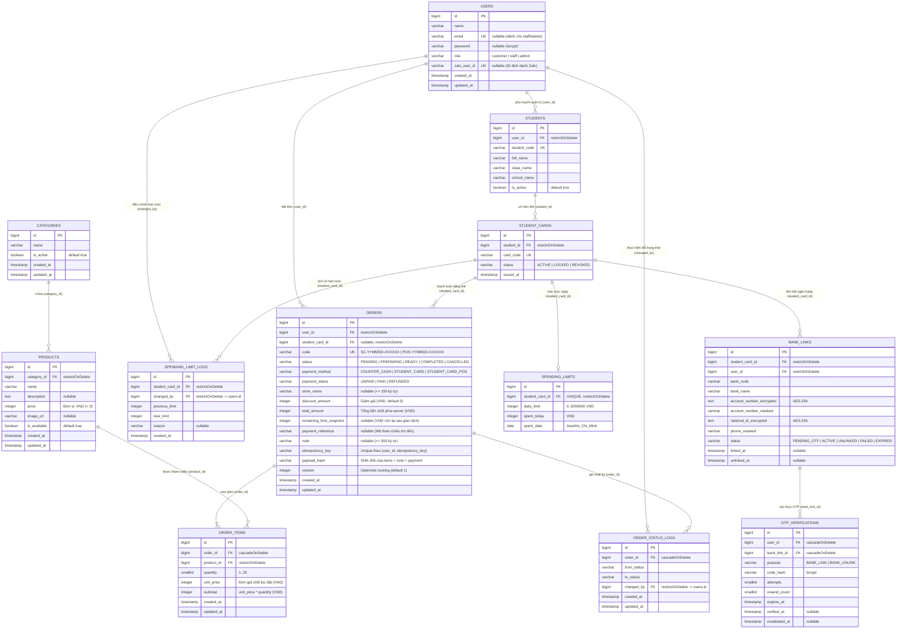

# Thiết kế Cơ sở Dữ liệu — Smart Canteen (`docs/database.md`)

- **Hệ quản trị CSDL:** PostgreSQL `17.5`
- **Database phát triển / trình diễn:** `titkul_canteen_demo`
- **Database kiểm thử tự động:** `titkul_canteen_test`
- **Bảng mã:** `UTF-8`
- **Quy ước tiền tệ:** Tất cả các cột giá và tổng tiền (`price`, `unit_price`, `subtotal`, `total_amount`) đều lưu dưới dạng **số nguyên không dấu (`INTEGER` / `unsignedInteger`) theo đơn vị `VND`**, tuyệt đối không dùng kiểu số thực (`FLOAT` / `DOUBLE`).

---

## 1. Sơ đồ Thực thể Kết hợp (Entity-Relationship Diagram)

---

## 2. Chi tiết Các Bảng & Ràng buộc Toàn vẹn (Tables & Constraints)

### 2.1. Bảng `users`
- **Migrations:** `0001_01_01_000000_create_users_table.php`, `2026_11_14_130001_add_role_and_zalo_to_users_table.php`
- **Đặc điểm:**
  - Khách hàng Zalo (`role = 'customer'`) được định danh qua `zalo_user_id` (`UNIQUE`, nullable), không bắt buộc có `email` hay `password`.
  - Nhân viên (`role = 'staff'`) và Quản trị viên (`role = 'admin'`) đăng nhập qua `email` (`UNIQUE`) và `password` (băm `bcrypt`).

### 2.2. Bảng `categories`
- **Migration:** `2026_11_14_101854_create_categories_table.php`
- **Đặc điểm:** Quản lý nhóm thực đơn (`Cơm`, `Bún & Phở`, `Mì & Món Á`, `Bánh mì & Ăn nhẹ`, `Đồ uống`, `Tráng miệng`). Khi `is_active = false`, danh mục và toàn bộ các món thuộc danh mục đó được ẩn khỏi API thực đơn công khai và không thể đặt mới.

### 2.3. Bảng `products`
- **Migration:** `2026_11_14_101855_create_products_table.php`
- **Khóa ngoại:** `category_id` tham chiếu `categories(id)` với `RESTRICT ON DELETE` (chặn xóa danh mục khi vẫn còn sản phẩm).
- **Chỉ mục:** Index trên `(category_id, is_available)`.

### 2.4. Bảng `orders`
- **Migration:** `2026_11_14_130002_create_orders_table.php`
- **Khóa ngoại:** `user_id` tham chiếu `users(id)` với `RESTRICT ON DELETE`.
- **Ràng buộc chống đơn trùng:** `UNIQUE (user_id, idempotency_key)` kết hợp cột `payload_hash` (`VARCHAR(64)`).
- **Kiểm soát đồng thời:** Cột `version` (`INTEGER`, mặc định `1`) tăng thêm `1` sau mỗi lần chuyển trạng thái thành công.

### 2.5. Bảng `order_items`
- **Migration:** `2026_11_14_130003_create_order_items_table.php`
- **Khóa ngoại:**
  - `order_id` tham chiếu `orders(id)` với `CASCADE ON DELETE`.
  - `product_id` tham chiếu `products(id)` với `RESTRICT ON DELETE` (không cho phép xóa sản phẩm đã từng nằm trong lịch sử đơn hàng).
- **Bảo toàn lịch sử giá (AC-11):** Lưu bản chụp `unit_price` và `subtotal` tại thời điểm đặt đơn.

### 2.6. Bảng `order_status_logs`
- **Migration:** `2026_11_14_150001_create_order_status_logs_table.php`
- **Khóa ngoại:**
  - `order_id` tham chiếu `orders(id)` với `CASCADE ON DELETE`.
  - `changed_by` tham chiếu `users(id)` với `RESTRICT ON DELETE`.
- **Chỉ mục:** Index trên `(order_id, id)` phục vụ truy xuất lịch sử chuyển trạng thái theo trình tự thời gian.

---

## 3. Dữ liệu Khởi tạo Mẫu (Seeders)

Chạy lệnh `php artisan migrate --seed` sẽ thực thi 3 Seeder idempotent (có thể chạy lặp lại nhiều lần không gây trùng dữ liệu):

1. **`MenuSeeder` (`api/database/seeders/MenuSeeder.php`):**
   - Khởi tạo **6 danh mục** (`Cơm`, `Bún & Phở`, `Mì & Món Á`, `Bánh mì & Ăn nhẹ`, `Đồ uống`, `Tráng miệng`).
   - Khởi tạo **30 món ăn** với giá từ `15.000 ₫` đến `55.000 ₫`, mỗi món được gán sẵn đường dẫn hình ảnh chuẩn `/images/products/<slug>.jpg` (trong đó có món *"Cơm cá kho tộ miền Tây"* và *"Bánh canh cua giò heo"* được đặt `is_available = false` để kiểm chứng trực tiếp giao diện "Hết món" và quy tắc chặn đặt món ngừng bán **AC-05**).
2. **`StaffSeeder` (`api/database/seeders/StaffSeeder.php`):**
   - Tài khoản Admin: `admin@smartcanteen.local` / mật khẩu `Admin@123456` (`role = admin`).
   - Tài khoản Staff: `staff@smartcanteen.local` / mật khẩu `Staff@123456` (`role = staff`).
3. **`StudentCardSeeder` (`api/database/seeders/StudentCardSeeder.php` — Trục 2 · Slice D1):**
   - Khởi tạo học sinh mẫu cho tài khoản demo `demo_customer1`: trường `THCS Trần Phú`, học sinh `Titkul Student`, lớp `8A2`, thẻ thông minh `F156BA` (`ACTIVE`, chưa liên kết ngân hàng).

---

## 4. Bảng Mở rộng Phân hệ Căn tin Số (Trục 2 · Slice D1–D3)

| Bảng | Migration | Mục đích & Ràng buộc bảo mật chính |
|---|---|---|
| **`students`** | `2026_11_25_100001_create_students_table.php` | Hồ sơ học sinh gắn `user_id` (`restrictOnDelete`), `student_code` UNIQUE, tên trường, lớp học. |
| **`student_cards`** | `2026_11_25_100002_create_student_cards_table.php` | Thẻ học sinh thông minh (`card_code` UNIQUE, `status`: `ACTIVE`/`LOCKED`/`REVOKED`). |
| **`bank_links`** | `2026_11_25_100003_create_bank_links_table.php` | Liên kết ngân hàng & trích nợ tự động. Mã hóa AES-256 (`account_number_encrypted`, `national_id_encrypted`), lưu bản che (`account_number_masked`, `national_id_masked`, `phone_masked`). **Partial Unique Index PostgreSQL:** `bank_links_one_active_per_card_idx ON bank_links (student_card_id) WHERE status = 'ACTIVE'`. |
| **`otp_verifications`** | `2026_11_25_100004_create_otp_verifications_table.php` | Xác thực OTP 6 chữ số cho `BANK_LINK` và `BANK_UNLINK`. Lưu `code_hash` (bcrypt, không lưu plaintext), theo dõi `attempts`/`max_attempts` (5), `resend_count`/`max_resends` (3), `last_sent_at`, `expires_at` (180s), `verified_at`, `invalidated_at`. |
| **`spending_limits`** | `2026_11_25_200001_create_spending_limits_table.php` | Cấu hình hạn mức chi tiêu hằng ngày (1-1 với `student_cards`): `daily_limit`, `spent_today`, `spent_date` (tự động reset hằng ngày theo `Asia/Ho_Chi_Minh`). |
| **`spending_limit_logs`** | `2026_11_25_200002_create_spending_limit_logs_table.php` | Nhật ký kiểm toán các lần thay đổi hạn mức (`previous_limit`, `new_limit`, `changed_by`, `reason`). |
| **`orders` (mở rộng)** | `2026_11_25_200003_add_canteen_payment_fields_to_orders_table.php` | Thêm `student_card_id` (nullable FK `restrictOnDelete`), `payment_method`, `payment_status`, `store_name`, `discount_amount`, `remaining_limit_snapshot`, `payment_reference`. |
