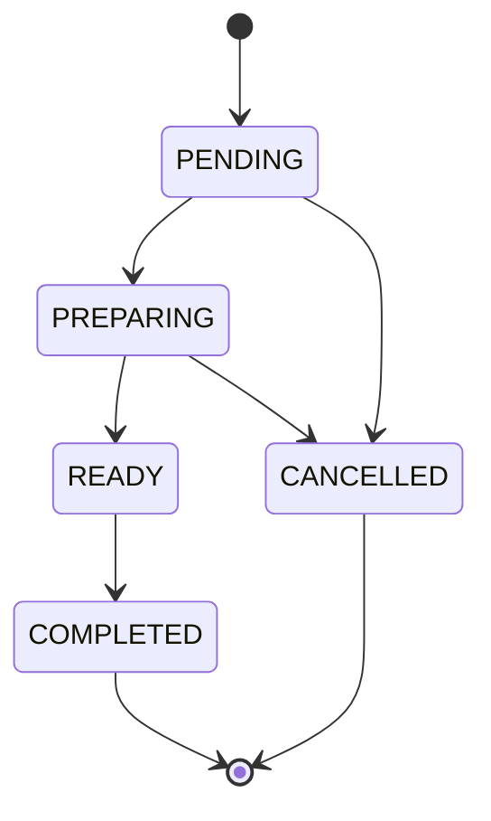

# Smart Canteen — Phân tích yêu cầu & Thiết kế (DRAFT — chờ phê duyệt)

- Ngày: 2026-11-14
- Nguồn: `BaiTestPart2.md` (đề xuất kỹ thuật đã được chọn phương án), `AGENTS.md`, `CLAUDE.md`, `DESIGN.md` (template rỗng)
- Trạng thái: **APPROVED 2026-11-14** bởi người dùng, với các quyết định: state machine như mục 2.4 (nhân viên hủy khi PENDING/PREPARING, khách không tự hủy); S1–S4 local trước, S5 deploy chỉ chạy khi được cấp quyền; đăng nhập Zalo thật (demo-login chỉ local); **database đổi sang PostgreSQL**.
- Ký hiệu: `[C]` CONFIRMED · `[I]` INFERRED · `[A]` ASSUMPTION (quyết định của agent, có thể sửa) · `[U]` UNKNOWN · `[X]` CONFLICTING

---

## 0. Khôi phục ngữ cảnh (Context Recovery)

| Hạng mục | Kết quả kiểm tra |
|---|---|
| Git | Thư mục **chưa phải Git repository** (`fatal: not a git repository`). |
| Mã nguồn | Chưa có. Chỉ có `BaiTestPart2.md`, `AGENTS.md`, `CLAUDE.md`, `DESIGN.md` (template, toàn placeholder), `README.md` (rỗng), `docs/PROJECT_STATE.md` (rỗng), các thư mục `docs/*` rỗng. |
| Công việc dở dang của người khác | Không phát hiện. |
| Môi trường | Node v24.16.0, npm 11.13.0, Git 2.47.0, PHP 8.5.12 (Herd, có `pdo_sqlite`, `pdo_mysql`, `pdo_pgsql`, `intl`, `bcmath`…), Composer 2.11.1. Không thấy `mysql`/`psql` CLI trên PATH. |
| Skills đã chọn | `superpowers:brainstorming` (đang dùng) → `superpowers:writing-plans` → `superpowers:executing-plans` + `superpowers:test-driven-development` → `frontend-ui-engineering` / `vercel-react-best-practices` (Mini App) → `superpowers:requesting-code-review` → `superpowers:verification-before-completion`. |

## 1. Phân tích yêu cầu

### A. Mục tiêu nghiệp vụ
`[C]` Chứng minh một luồng full-stack end-to-end chạy thật: khách đặt món trên Zalo Mini App → Laravel xác thực, tính tiền phía server, lưu DB riêng → nhân viên xử lý trên Admin → khách thấy trạng thái mới. Dữ liệu 100% giả lập, không chạm production Căn Tin Số.

### B. Vai trò
- `[C]` **Customer** — dùng Mini App.
- `[C]` **Staff** — tiếp nhận đơn, đổi trạng thái (Admin).
- `[C]` **Admin** — như Staff + xem thống kê. `[A]` Admin quản lý thực đơn (CRUD món) để ở **P1/P2**, P0 dùng seed.

### C. Yêu cầu chức năng (theo ưu tiên)
- **P0** `[C]`: danh sách món, chi tiết món, giỏ hàng (thêm/xóa/đổi số lượng), tạo đơn, lịch sử đơn, chi tiết/theo dõi đơn, Admin đổi trạng thái, đồng bộ trạng thái về Mini App (polling 5–10s).
- **P1** `[C]`: định danh/đăng nhập, RBAC Customer–Staff–Admin, validation, thống kê đơn, tìm kiếm, chống đơn trùng, bảo vệ API.
- **P2** `[C]` (ngoài phạm vi hiện tại): QR tại bàn, mã nhận món, thông báo, khuyến mãi, thanh toán online, báo cáo nâng cao.

### D. Phi chức năng
- `[C]` HTTPS + CORS đúng (origin `https://h5.zdn.vn`, preflight `OPTIONS`) khi lên Zalo; không phụ thuộc cookie/localStorage ở Mini App.
- `[C]` Không đưa App Secret/private key vào React; secrets chỉ ở `.env` backend, không commit.
- `[C]` Status code & định dạng lỗi nhất quán.
- `[C]` Modular monolith, không microservices/Kafka/Redis/WebSocket.

### E. Business rules `[C]`
1. Backend tự tính tổng từ giá trong DB; bỏ qua mọi `total_amount`/giá do client gửi.
2. Từ chối đơn có sản phẩm ngừng bán / không tồn tại / số lượng không hợp lệ.
3. Customer chỉ xem đơn của mình; Staff/Admin xem tất cả.
4. Chuyển trạng thái phải hợp lệ theo state machine.
5. Tạo `orders` + `order_items` trong một DB transaction.
6. Chống tạo đơn trùng (idempotency key).
7. Tiền là số nguyên VND; `unit_price`/`subtotal`/`total_amount` chốt tại thời điểm đặt.

### F. Input/Output chính
- `POST /api/v1/orders` — in: `items[{product_id, quantity}]`, `note?`, header `Idempotency-Key`; out: order (id, code, status, total_amount, items, created_at).
- `PATCH /api/v1/admin/orders/{id}/status` — in: `status`, `version`; out: order mới.

### G. Kịch bản lỗi
| Tình huống | HTTP |
|---|---|
| Chưa xác thực / token hết hạn | 401 |
| Không đủ quyền / xem đơn người khác | 403 (hoặc 404 để không lộ sự tồn tại — `[A]` chọn **404** cho đơn người khác) |
| Validation (số lượng ≤0, >max, món không tồn tại, món ngừng bán, giỏ rỗng) | 422 |
| Chuyển trạng thái không hợp lệ | 422 |
| Xung đột version (2 nhân viên cùng sửa) | 409 |
| Cùng Idempotency-Key nhưng payload khác | 409 |
| Lỗi mạng / server ở Mini App | hiện trạng thái Error + nút thử lại |

Định dạng lỗi `[A]`: `{ "message": string, "errors"?: { field: string[] } }` (giữ chuẩn mặc định của Laravel).

### H. Phụ thuộc
- Zalo Mini App ID (tài khoản Developer **cá nhân** — `[C]` đã chọn).
- Backend staging HTTPS (`[U]` — xem mục 4).
- Zalo App Secret cho xác minh định danh (`[U]` — có khi tạo Mini App ID).

### I. Acceptance criteria có thể kiểm thử (mapping từ checklist mục 9)
| ID | Tiêu chí | Cách kiểm chứng |
|---|---|---|
| AC-01 | Seed ≥10 sản phẩm, ≥3 danh mục (giả lập) | Feature test + `GET /products` |
| AC-02 | Xem danh sách/chi tiết món trên Mini App | Component test + chạy thủ công local |
| AC-03 | Thêm/xóa món, đổi số lượng trong giỏ | Unit test logic giỏ (Vitest) |
| AC-04 | Tạo đơn thành công, tổng tiền tính ở backend | Feature test (gửi total giả → bị bỏ qua) |
| AC-05 | Từ chối món ngừng bán / số lượng sai | Feature test 422 |
| AC-06 | Chặn gửi trùng đơn | Feature test cùng key → 1 đơn |
| AC-07 | Admin thấy đơn vừa tạo | Feature test Blade/API + thủ công |
| AC-08 | Admin chuyển trạng thái đúng quy tắc, có log | Unit test state machine + feature test |
| AC-09 | Mini App cập nhật trạng thái & lịch sử (polling) | Thủ công 2 cửa sổ + test hook |
| AC-10 | User không xem được đơn người khác | Feature test 404 |
| AC-11 | Giá đổi sau khi đặt không làm đổi đơn cũ | Feature test |
| AC-12 | Không có dữ liệu/secret production | Review + `.gitignore` |
| AC-13 | README, test cases, demo script | Review tài liệu |
| AC-14..16 | Mở trên Zalo bằng QR, tài khoản giám đốc có quyền, backend HTTPS ngoài mạng nội bộ | **BLOCKED** — cần quyền deploy (NOT AUTHORIZED) |

### J. Ngoài phạm vi (đợt này)
Toàn bộ P2; deploy Zalo Development/Testing; deploy backend staging; React Admin; CRUD thực đơn trên Admin; thanh toán; WebSocket.

### Phân loại thông tin
- **UNKNOWN `[U]`**: (1) sơ đồ state machine — tài liệu ghi "Ví dụ state machine đơn hàng" nhưng **hình bị mất**; (2) nơi đặt backend staging; (3) giới hạn số lượng tối đa mỗi món; (4) khách có được tự hủy đơn không; (5) Design tokens (`DESIGN.md` toàn placeholder).
- **CONFLICTING `[X]`**: Đề xuất cho phép "Laravel Blade **hoặc** React" cho Admin và "MySQL **hoặc** PostgreSQL" → chọn Blade (bảng công nghệ ghi rõ Blade) và SQLite local / Postgres staging (xem mục 3).
- **Phát hiện quan trọng `[I]` (cần kiểm chứng tài liệu chính thức)**: Zalo Open API (`graph.zalo.me/v2.0/me`, dùng để xác minh `access_token` kèm `appsecret_proof` HMAC-SHA256) **có thể yêu cầu gọi từ máy chủ đặt tại Việt Nam**. Điều này ảnh hưởng trực tiếp đến lựa chọn hosting miễn phí (Render/Fly/Koyeb đều ở nước ngoài).
- **Bảo mật**: Tài liệu ghi nhận mật khẩu production đã bị chia sẻ trong hội thoại → khuyến nghị đổi mật khẩu ngay. Dự án này không dùng/không lưu mật khẩu đó.

## 2. Phương án kiến trúc (Approaches)

### 2.1 Backend Laravel — người dùng giao quyền chọn "chuẩn phổ biến nhất"
| Phương án | Đánh đổi |
|---|---|
| **(Chọn) Laravel chuẩn MVC + Form Request + API Resource + Policy + Service/Action class** | Đúng convention chính thức Laravel, ít abstraction; logic nghiệp vụ tách vào `app/Services` (đúng gợi ý `OrderService` của tài liệu); dễ test. |
| Repository pattern + Interface cho mọi model | Phổ biến trong một số team nhưng trùng chức năng với Eloquent, nhiều boilerplate → vi phạm "không thêm abstraction thừa". |
| DDD / module-per-domain (`app/Domain/...`) | Quá nặng cho MVP 7 ngày. |

Cấu trúc dự kiến:
```
api/app/
  Enums/OrderStatus.php            # backed enum + allowedTransitions()
  Http/Controllers/Api/V1/{CategoryController,ProductController,OrderController,AuthController}.php
  Http/Controllers/Api/V1/Admin/{OrderController,StatisticsController}.php
  Http/Controllers/Admin/...       # Blade admin (session guard)
  Http/Requests/{StoreOrderRequest,UpdateOrderStatusRequest}.php
  Http/Resources/{ProductResource,OrderResource,...}.php
  Models/{User,Category,Product,Order,OrderItem,OrderStatusLog}.php
  Policies/OrderPolicy.php
  Services/{OrderService,ZaloIdentityService}.php
  Exceptions/...                   # InvalidStatusTransition, VersionConflict
```
Test: PHPUnit (mặc định của Laravel, không thêm Pest), SQLite in-memory.

### 2.2 Xác thực
- `[A]` **Customer**: Mini App gọi `getAccessToken()` (zmp-sdk) → `POST /api/v1/auth/zalo` → Laravel gọi `graph.zalo.me/v2.0/me` với `appsecret_proof` → upsert user theo `zalo_user_id` → trả **Sanctum personal access token** (Bearer). Không tin `zalo_user_id` do client gửi.
- `[A]` **Chế độ demo/local**: `POST /api/v1/auth/demo` chỉ bật khi `APP_ENV=local` **và** `DEMO_LOGIN_ENABLED=true`, trả token cho tài khoản khách giả lập — để phát triển trên trình duyệt (ngoài Zalo không có access token). Không gọi đây là "đăng nhập bằng Zalo".
- `[A]` **Staff/Admin**: Blade dùng session guard (email + mật khẩu seed chỉ cho local); API `/admin/*` dùng Sanctum + kiểm tra role qua Policy/Gate.

### 2.3 Database
- `[C]` (người dùng chốt 2026-11-14) **PostgreSQL** cho local và staging. Database riêng `titkul_canteen_demo`, user riêng tối thiểu quyền.
- `[A]` Trên máy hiện **chưa có PostgreSQL server** (cổng 5432 đóng). Trong lúc chờ cài đặt, test tự động có thể chạy tạm trên SQLite in-memory (migrations viết trung lập, không dùng tính năng riêng của DB); kết quả trên PostgreSQL được ghi nhận riêng và là cổng kiểm chứng bắt buộc trước khi đóng mỗi lát cắt.
- Bảng theo mục 5.1 tài liệu + bổ sung tối thiểu: `users.email/password` (staff), `products.description`, `orders.note`, `orders.idempotency_key` (unique theo `user_id`), `personal_access_tokens` (Sanctum).
- `orders.code` `[A]`: `SC-YYMMDD-<id 6 chữ số>`, unique.
- `orders.version` `[C]`/`[A]`: optimistic locking — PATCH status phải gửi `version`, sai → 409.

### 2.4 State machine đơn hàng — **CẦN XÁC NHẬN**
Đề xuất `[A]` (dựa trên luồng demo `PENDING → PREPARING → READY` và câu "xác nhận hoàn thành"):

Chỉ Staff/Admin được chuyển trạng thái; khách **không** tự hủy ở P0. Mỗi lần chuyển ghi `order_status_logs`.

### 2.5 Mini App
- `[C]` `npx create-zalo-mini-app miniapp` (React + TypeScript), ZaUI (`zmp-ui`), Tailwind nếu template có sẵn.
- `[A]` Data fetching: **TanStack Query** (tài liệu liệt kê; dùng `refetchInterval: 7000` cho polling trạng thái, chỉ khi màn hình đang mở và đơn chưa ở trạng thái cuối).
- `[A]` Giỏ hàng: state trong bộ nhớ (store của template nếu có, ví dụ Jotai; nếu không thì React context) — không dùng localStorage.
- `[A]` Màn hình: Thực đơn (lọc danh mục + tìm kiếm), Chi tiết món, Giỏ hàng, Đơn của tôi, Chi tiết/theo dõi đơn. Mỗi màn có Loading/Error/Empty/Success.
- `[A]` `DESIGN.md` chưa có tokens → dùng mặc định ZaUI + bổ sung tối thiểu, ghi lại tokens vào `DESIGN.md` như "documented assumption".
- Test: Vitest cho logic giỏ hàng & API client.

### 2.6 Admin (Blade)
- `[C]` Laravel Blade. `[A]` Trang danh sách đơn (lọc theo trạng thái, tìm theo mã), chi tiết đơn + nút chuyển trạng thái hợp lệ, trang thống kê cơ bản (số đơn theo trạng thái, doanh thu đơn COMPLETED hôm nay). Tự làm mới bằng polling nhẹ (10s). Không thêm framework JS.

## 3. Lát cắt triển khai (Vertical Slices) — mỗi đợt một lát
| # | Lát cắt | Kết quả quan sát được |
|---|---|---|
| S1 | Khởi tạo monorepo (`git init`, `api/`, `miniapp/`) + Menu: migrations/seed categories & products, `GET categories/products/{id}`, Mini App màn Thực đơn + Chi tiết | Mini App local hiển thị món thật từ Laravel |
| S2 | Auth (demo + Zalo flow) + Giỏ hàng + `POST/GET /orders` (transaction, idempotency, tính tiền server) + Đơn của tôi | Đặt đơn từ Mini App, lưu DB |
| S3 | Admin Blade + state machine + `PATCH status` (version, log) + polling Mini App | Luồng demo 8 bước chạy trên local |
| S4 | RBAC hoàn chỉnh, thống kê, tìm kiếm, tài liệu (API contract, DB, test cases, demo script, README) | P1 hoàn tất, sẵn sàng UAT local |
| S5 | Deploy staging + Zalo Testing | **Cần phê duyệt riêng** (Deployment NOT AUTHORIZED) |

## 4. Backend staging (quyết định hoãn — không chặn S1–S4)
| Phương án miễn phí | Ưu | Nhược |
|---|---|---|
| **(Đề xuất cho demo) Cloudflare Tunnel từ laptop tại VN** (`cloudflared`) | Miễn phí, HTTPS hợp lệ, IP Việt Nam (đáp ứng nghi vấn giới hạn IP của Zalo Open API), dữ liệu ở máy bạn | Laptop phải bật khi demo; quick tunnel đổi URL mỗi lần (named tunnel cần domain trên Cloudflare); cần cài `cloudflared` (công cụ ngoài — cần phê duyệt) |
| Render (free web service, Docker) + Neon (free Postgres) | Không phụ thuộc laptop | Cold start ~30–60s; server ngoài VN → có thể bị Zalo Open API chặn; cần Dockerfile |
| VPS Việt Nam | Ổn định nhất | Không miễn phí |

## 4b. Quyết định bổ sung sau builder check (quyết định của agent — có thể sửa)
- `[A]` **Admin API + Blade**: xây cả `/api/v1/admin/*` (đã có trong API contract mục 5.2 của tài liệu — `[C]`) và Blade. Cả hai gọi chung `OrderService`, nên không nhân đôi logic; Blade dùng session guard, API dùng Sanctum, cùng một `OrderPolicy`.
- `[A]` **Quản lý thực đơn tối thiểu** (sửa giá, bật/tắt `is_available`) trên Admin Blade ở **S4**, để demo trực tiếp AC-05/AC-11. CRUD đầy đủ (thêm/xóa món, upload ảnh) vẫn ngoài phạm vi.

## 5. Những gì để builder tự quyết
Tên biến/thư mục chi tiết, layout Blade, giới hạn số lượng mặc định (`[A]` 1–20 mỗi món, ≤ 50 dòng/đơn), số món seed cụ thể và hình ảnh (placeholder không bản quyền).
