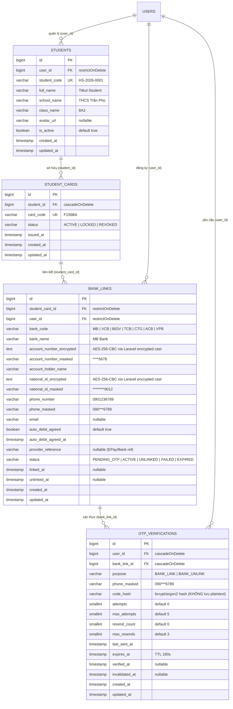

# Smart Canteen — Thiết kế Chi tiết Trục 2 · Slice D1: Hồ sơ Học sinh, Thẻ Thông minh & Liên kết Ngân hàng + OTP

- **Ngày:** 2026-11-25
- **Trạng thái:** **APPROVED 2026-11-25** bởi người dùng.
- **Nguồn yêu cầu:** [FEATURES.md](../../../FEATURES.md) (Mục 3.1 `CARD-01..07`, Mục 3.2 `BANK-01..16`, Mục 3.3 `OTP-01..08`, Mục 7 Production-Ready Gaps) + Phương án đã chốt **`3A`** (mở rộng & hợp nhất trực tiếp vào Smart Canteen hiện có).
- **Môi trường mục tiêu:** Local / Development / Testing (100% mô phỏng adapter ngân hàng/EPay cục bộ sau interface tách bạch, không kết nối ngân hàng thật).
- **Ký hiệu:** `[C]` CONFIRMED · `[I]` INFERRED · `[A]` ASSUMPTION (quyết định kỹ thuật của agent, có thể chỉnh sửa)

---

## 1. Mục tiêu Nghiệp vụ & Phạm vi Slice D1

### Mục tiêu (Business Objective)
`[C]` Bổ sung nền tảng phân hệ **Căn tin Số (Digital Canteen)** vào ứng dụng Smart Canteen hiện có, cho phép phụ huynh/khách hàng trên Zalo Mini App:
1. Xem **Thẻ học sinh thông minh** gắn với tài khoản (`CARD-01..07`).
2. Kiểm tra trạng thái liên kết ngân hàng và thực hiện đầy đủ luồng **Liên kết tài khoản ngân hàng — Đăng ký trích nợ tự động** (`BANK-01..16`).
3. Xác thực giao dịch liên kết bằng **OTP 6 chữ số** an toàn, bao gồm cả các tình huống thực tế (sai OTP, giới hạn lượt thử, hết hạn TTL, gửi lại có cooldown, quay lại sửa SĐT) (`OTP-01..07`).

### Ngoài phạm vi Slice D1 (Đã lên lịch cho D2 & D3)
- **Slice D2:** Thiết lập/thay đổi hạn mức chi tiêu hằng ngày + chọn nhanh `20k/30k/50k/100k` + lịch sử hạn mức (`LIMIT-01..13`), tích hợp trừ hạn mức tự động khi đặt đơn / mô phỏng quẹt thẻ POS, hoàn hạn mức khi hủy đơn, chi tiết đơn gắn thẻ (`DETAIL-01..14`).
- **Slice D3:** Luồng Hủy liên kết ngân hàng qua xác nhận & OTP (`UNLINK-01..07`, `OTP-08`), giao diện quản trị Học sinh / Thẻ / Liên kết / Giao dịch trên Laravel Blade Admin, kiểm thử E2E toàn bộ 4 luồng.

### Anti-Goals
- Không làm vỡ bất kỳ API/UI/Test nào của MVP đặt món hiện có (53 PHPUnit tests + 18 Vitest tests).
- Không lưu số tài khoản ngân hàng, số CCCD hoặc mã OTP dưới dạng plaintext trong DB, log hoặc API response.
- Không gọi API thật của MB Bank/EPay; không lộ `debug_otp` khi `APP_ENV=production`.

---

## 2. Phân tích Yêu cầu & Tiêu chí Nghiệm thu (Traceability)

| Nhóm | Mã yêu cầu (`FEATURES.md`) | Hành vi được triển khai trong Slice D1 |
|---|---|---|
| **Thẻ học sinh** | `CARD-01..07` | Hiển thị thẻ thông minh với mã thẻ (`F156BA`), tên trường (`THCS Trần Phú`), tên học sinh (`Titkul Student`), lớp (`8A2`), trạng thái hoạt động (`Đang hoạt động` / `Tạm khóa`), trạng thái liên kết ngân hàng (`Chưa liên kết` / `Đã liên kết`). |
| **Liên kết ngân hàng** | `BANK-01..16` | Kiểm tra trạng thái liên kết; chọn ngân hàng từ danh sách (MB Bank, Vietcombank, BIDV, Techcombank, VietinBank, ACB, VPBank); nhập STK, tên chủ TK, CCCD 12 số, SĐT VN 10 số, email tùy chọn; Form validation hai lớp (client + server); xác nhận điều khoản trích nợ tự động; xác thực OTP 6 số; hiển thị ngân hàng đã liên kết kèm data masking (`****5678`); trạng thái liên kết thành công & tuyên bố bảo mật mã hóa. |
| **Xác thực OTP** | `OTP-01..07` | Thông báo gửi OTP đến SĐT đã che (`090***6789`); nhập 6 chữ số (6 ô nhập hỗ trợ paste & bàn phím); xác nhận OTP + trạng thái đang xác thực; quay lại chỉnh sửa giữ nguyên dữ liệu form khi sai SĐT; xử lý OTP sai (hiển thị lượt thử còn lại, tối đa 5 lượt), OTP hết hạn (TTL 180s), gửi lại OTP (cooldown 30s, tối đa 3 lần). |

---

## 3. Thiết kế Cơ sở Dữ liệu (PostgreSQL 17 — 4 Migrations Bổ sung)

> Tất cả migrations đều là **additive** (không sửa đổi hay phá vỡ 6 bảng hiện có). Thiết kế sẵn các cột cần thiết cho D2 & D3 (`unlinked_at`, `purpose = BANK_UNLINK`) để tránh migration phá vỡ về sau.



### Ràng buộc Toàn vẹn & Bảo mật CSDL
1. **Partial Unique Index (PostgreSQL):**
   ```sql
   CREATE UNIQUE INDEX bank_links_one_active_per_card_idx
   ON bank_links (student_card_id)
   WHERE status = 'ACTIVE';
   ```
   Ngăn chặn tuyệt đối race condition tạo 2 liên kết `ACTIVE` cùng lúc trên 1 thẻ học sinh.
2. **Encryption-at-Rest & Masking:**
   - `account_number_encrypted` và `national_id_encrypted` dùng Laravel `'encrypted'` cast (mã hóa AES-256 bằng `APP_KEY`), đánh dấu `#[Hidden]` trên Model `BankLink`.
   - API Resource **chỉ trả** `account_number_masked` (`****5678`), `national_id_masked` (`********9012`), `phone_masked` (`090***6789`) — không bao giờ trả số tài khoản hay CCCD đầy đủ.
3. **OTP Hashing:** `otp_verifications.code_hash` băm bằng `Hash::make()` (đánh dấu `#[Hidden]`), không ghi mã OTP ra application logs ở production.
4. **Seeder & Local Provisioning (`[A]`):**
   - `StudentCardSeeder` (idempotent) tạo sẵn tài khoản demo `demo_customer1` (nếu chưa có) cùng học sinh mẫu: trường `THCS Trần Phú`, học sinh `Titkul Student`, lớp `8A2`, mã thẻ `F156BA` (`ACTIVE`, chưa liên kết ngân hàng để sẵn sàng demo toàn bộ luồng liên kết).
   - Khi một user mới đăng nhập ở môi trường `local` (khi `DEMO_LOGIN_ENABLED=true` và `BANKING_AUTO_PROVISION_DEMO_CARD=true`) chưa có thẻ học sinh, `StudentCardService` tự cấp 1 thẻ học sinh demo mặc định; ở môi trường `testing` (PHPUnit) và `production`, cờ này mặc định `false` để kiểm thử xác định tuyệt đối và UI production hiển thị `EmptyState` rõ ràng.

---

## 4. Kiến trúc Backend & Ranh giới Tích hợp (Adapter Pattern)

### 4.1. Các Thành phần mới trong `api/`
- **Enums:** `App\Enums\StudentCardStatus` (`ACTIVE`, `LOCKED`, `REVOKED`), `App\Enums\BankLinkStatus` (`PENDING_OTP`, `ACTIVE`, `UNLINKED`, `FAILED`, `EXPIRED`), `App\Enums\OtpPurpose` (`BANK_LINK`, `BANK_UNLINK`).
- **Models & Policies:** `Student`, `StudentCard`, `BankLink`, `OtpVerification`; `StudentCardPolicy` & `BankLinkPolicy` (chặn truy cập chéo bằng `404 Not Found` nhất quán với `OrderPolicy`).
- **Banking Gateway Boundary:**
  - Interface `App\Contracts\BankingGatewayInterface`:
    - `listSupportedBanks(): array`
    - `initiateAutoDebitLink(array $payload): array` (trả `provider_reference`)
    - `confirmAutoDebitLink(string $providerReference): array`
    - `unlinkAutoDebit(string $providerReference): array` *(sẵn sàng cho D3)*
  - Implementation `App\Services\Banking\MockEpayBankingGateway` (bind mặc định qua `AppServiceProvider`, cấu hình qua `config('services.banking')`: `driver`, `otp_ttl_seconds=180`, `otp_resend_cooldown_seconds=30`, `otp_max_attempts=5`, `otp_max_resends=3`, `expose_debug_otp` chỉ cho phép khi `local`/`testing`).
- **Domain Services:**
  - `App\Services\DataMaskingService`: hàm thuần xác định che STK (`****5678`), che CCCD (`********9012`), che SĐT (`090***6789`) — dễ unit test.
  - `App\Services\StudentCardService`: lấy danh sách / chi tiết thẻ của user kèm liên kết ngân hàng hiện tại.
  - `App\Services\BankLinkingService`: quản lý toàn bộ giao dịch `initiateLink()`, `verifyOtp()`, `resendOtp()` bên trong `DB::transaction()` + `lockForUpdate()`, ném domain exceptions có mã lỗi rõ ràng (`BankLinkConflictException` → `409`, `OtpVerificationException` → `422`/`429`).

---

## 5. Hợp đồng REST API (`/api/v1/canteen/*`)

Mọi response lỗi giữ nguyên cấu trúc chuẩn của hệ thống (`{ "message": "...", "error_code"?: "...", "errors"?: {...}, "meta"?: {...} }`).

### 5.1. `GET /api/v1/canteen/banks` (Public)
Trả danh sách ngân hàng hỗ trợ trích nợ tự động:
```json
{
  "data": [
    {
      "code": "MB",
      "name": "Ngân hàng TMCP Quân đội (MB Bank)",
      "short_name": "MB Bank",
      "account_min_length": 6,
      "account_max_length": 19
    }
  ]
}
```

### 5.2. `GET /api/v1/canteen/cards` (`auth:sanctum`)
Trả danh sách thẻ học sinh thông minh của người dùng hiện tại (`CARD-01..07`):
```json
{
  "data": [
    {
      "id": 1,
      "card_code": "F156BA",
      "status": "ACTIVE",
      "issued_at": "2026-11-25T08:00:00+00:00",
      "student": {
        "id": 1,
        "student_code": "HS-2026-0001",
        "full_name": "Titkul Student",
        "school_name": "THCS Trần Phú",
        "class_name": "8A2",
        "avatar_url": null
      },
      "is_bank_linked": false,
      "bank_link": null
    }
  ]
}
```
Khi đã liên kết (`is_bank_linked: true`), `bank_link` chứa:
```json
{
  "id": 10,
  "bank_code": "MB",
  "bank_name": "MB Bank",
  "account_number_masked": "****5678",
  "account_holder_name": "NGUYEN VAN A",
  "national_id_masked": "********9012",
  "phone_masked": "090***6789",
  "email": "phuhuynh@example.com",
  "status": "ACTIVE",
  "auto_debit_agreed": true,
  "linked_at": "2026-11-25T08:15:00+00:00"
}
```

### 5.3. `GET /api/v1/canteen/cards/{cardId}` (`auth:sanctum`)
Chi tiết 1 thẻ học sinh. Trả `404 Not Found` nếu thẻ không tồn tại hoặc thuộc người dùng khác.

### 5.4. `POST /api/v1/canteen/cards/{cardId}/bank-links` (`auth:sanctum`)
Khởi tạo đăng ký liên kết ngân hàng + trích nợ tự động và cấp OTP 6 chữ số (`BANK-02..11`, `OTP-01`, `OTP-07`):
- **Request Body:**
  ```json
  {
    "bank_code": "MB",
    "account_number": "01234567895678",
    "account_holder_name": "NGUYEN VAN A",
    "national_id": "079204009012",
    "phone_number": "0901236789",
    "email": "phuhuynh@example.com",
    "agreed_terms": true
  }
  ```
- **Validation Rules:**
  - `bank_code`: bắt buộc, nằm trong danh sách ngân hàng hỗ trợ.
  - `account_number`: bắt buộc, chỉ gồm chữ số (`^\d+$`), độ dài khớp quy định của ngân hàng (`6..20`).
  - `account_holder_name`: bắt buộc, `2..150` ký tự.
  - `national_id`: bắt buộc, đúng `12` chữ số CCCD (`digits:12`).
  - `phone_number`: bắt buộc, đúng định dạng SĐT di động Việt Nam (`^0[35789]\d{8}$`).
  - `email`: tùy chọn (`nullable|email|max:150`).
  - `agreed_terms`: bắt buộc `accepted` (`true`).
- **Quy tắc nghiệp vụ:**
  - Trả `404` nếu thẻ không thuộc user; trả `422` nếu thẻ ở trạng thái `LOCKED`/`REVOKED`; trả `409 Conflict` nếu thẻ đã có liên kết `ACTIVE`.
  - Vô hiệu hóa mọi phiên `PENDING_OTP` trước đó của thẻ, tạo `bank_links` (`PENDING_OTP`) và `otp_verifications` (`BANK_LINK`, TTL `180s`).
- **Response `201 Created`:**
  ```json
  {
    "data": {
      "bank_link_id": 10,
      "student_card_id": 1,
      "status": "PENDING_OTP",
      "bank_code": "MB",
      "bank_name": "MB Bank",
      "account_number_masked": "****5678",
      "phone_masked": "090***6789",
      "otp": {
        "expires_in_seconds": 180,
        "resend_cooldown_seconds": 30,
        "max_attempts": 5,
        "remaining_attempts": 5,
        "max_resends": 3,
        "remaining_resends": 3,
        "debug_otp": "482910"
      }
    }
  }
  ```
  *(Trường `debug_otp` CHỈ xuất hiện khi `APP_ENV` thuộc `['local', 'testing']` và `BANKING_EXPOSE_DEBUG_OTP=true`; tự động lược bỏ hoàn toàn trên `production`.)*

### 5.5. `POST /api/v1/canteen/bank-links/{bankLinkId}/verify-otp` (`auth:sanctum`)
Xác thực OTP 6 chữ số để hoàn tất liên kết (`OTP-02..05`, `BANK-12..15`):
- **Request Body:** `{ "otp_code": "482910" }` (validate `required|digits:6`).
- **Response `200 OK`:** Trả `StudentCardResource` đã cập nhật (`is_bank_linked: true`, `bank_link.status = "ACTIVE"`).
- **Lỗi chuẩn:**
  - `404`: `bankLinkId` không thuộc user hiện tại.
  - `409 Conflict` (`BANK_LINK_ALREADY_ACTIVE` / `BANK_LINK_INVALID_STATE`): phiên liên kết không còn ở trạng thái `PENDING_OTP`.
  - `422 Unprocessable Entity` (`OTP_INVALID`): sai OTP, kèm `meta.remaining_attempts`.
  - `422 Unprocessable Entity` (`OTP_EXPIRED`): hết hạn sau 180s.
  - `429 Too Many Requests` (`OTP_MAX_ATTEMPTS_EXCEEDED`): sai quá 5 lần, phiên OTP bị khóa.

### 5.6. `POST /api/v1/canteen/bank-links/{bankLinkId}/resend-otp` (`auth:sanctum`)
Gửi lại mã OTP mới cho phiên `PENDING_OTP`:
- Trả `200 OK` kèm metadata OTP mới (`expires_in_seconds`, `resend_cooldown_seconds`, `remaining_resends`, và `debug_otp` nếu local/testing).
- Trả `429 Too Many Requests` (`OTP_RESEND_COOLDOWN` kèm `meta.retry_after_seconds` nếu chưa đủ `30s`; hoặc `OTP_MAX_RESENDS_EXCEEDED` nếu đã vượt `3` lần gửi lại).

---

## 6. Thiết kế Giao diện Mini App (Tuân thủ `DESIGN.md` & WCAG 2.1 AA)

### 6.1. Điều hướng & Các Tuyến mới
- Cập nhật `BottomNav` ([bottom-nav.tsx](../../../miniapp/src/components/bottom-nav.tsx)) sang 4 tab cân đối (`grid-cols-4`):
  - `Thực đơn` (`/`) · `Căn tin số` (`/canteen`) · `Giỏ hàng` (`/cart`) · `Đơn của tôi` (`/orders`)
- Bổ sung 3 tuyến trong [layout.tsx](../../../miniapp/src/components/layout.tsx):
  - `/canteen` → `CanteenHubPage`
  - `/canteen/link-bank` → `BankLinkFormPage`
  - `/canteen/verify-otp` → `BankLinkOtpPage`

### 6.2. Thiết kế Màn hình (Text Sketches & UI Contract)
1. **Màn hình `/canteen` (`CanteenHubPage` — `CARD-01..07`, `BANK-01`, `BANK-13..16`):**
   - Dùng hệ màu thương hiệu Smart Canteen (`brand-700: #2E7D32`, `brand-900: #14532D`, nền `#F6F8F5`, card `#FFFFFF`), không dùng màu tím/gradient AI mặc định.
   - **Thẻ học sinh thông minh (`StudentCardView`):**
     ```text
     ┌───────────────────────────────────────────┐
     │ THCS Trần Phú           [● Đang hoạt động]│
     │ Thẻ học sinh thông minh                   │
     │                                           │
     │ MÃ THẺ: F156BA                            │
     │ HỌC SINH: Titkul Student      LỚP: 8A2    │
     │ [Chưa liên kết ngân hàng / Đã liên kết]   │
     └───────────────────────────────────────────┘
     ```
   - **Trạng thái Chưa liên kết:** Hộp giải thích dịch vụ trích nợ tự động + nút chính *"Liên kết tài khoản ngân hàng"* + tuyên bố bảo mật & mã hóa chuẩn AES-256 (`BANK-16`).
   - **Trạng thái Đã liên kết:** Hộp thông tin ngân hàng (`MB Bank`, STK `****5678`, chủ TK `NGUYEN VAN A`, badge `Đã liên kết`), banner thông báo thành công khi vừa xác thực xong (`BANK-15`), tuyên bố bảo mật (`BANK-16`), và khối thông tin chuẩn bị cho **Slice D2 (Hạn mức chi tiêu hằng ngày)** & **Slice D3 (Hủy liên kết)**.
2. **Màn hình `/canteen/link-bank` (`BankLinkFormPage` — `BANK-03..11`, `BANK-16`):**
   - Bộ chọn ngân hàng trực quan (`BankSelector`, hỗ trợ tìm nhanh và phím bàn phím).
   - Form có nhãn rõ ràng (`<label htmlFor>`), hiển thị lỗi ngay dưới từng ô (`aria-invalid`, `aria-describedby`): Số tài khoản, Tên chủ tài khoản, Số CCCD (12 chữ số), Số điện thoại, Email (không bắt buộc).
   - Checkbox xác nhận điều khoản đăng ký trích nợ tự động + tuyên bố mã hóa & bảo mật.
   - Lưu tạm draft form trong Jotai in-memory (`canteenLinkDraftAtom`, không dùng `localStorage`) để khi bấm *"Quay lại chỉnh sửa"* từ màn OTP (`OTP-06`), người dùng sửa SĐT ngay mà không mất dữ liệu vừa nhập; tự xóa draft khi liên kết thành công.
3. **Màn hình `/canteen/verify-otp` (`BankLinkOtpPage` — `OTP-01..07`):**
   - Hiển thị SĐT đã che (`090***6789`) và đồng hồ đếm ngược TTL (`03:00`).
   - Ô nhập OTP 6 chữ số (`OtpCodeInput`: 6 ô `inputMode="numeric"`, hỗ trợ paste 6 số, phím Backspace/Arrow).
   - Khi backend trả `debug_otp` (chỉ ở local/testing): hiển thị khung thông báo rõ *"Chế độ Demo Local — Mã OTP mô phỏng: `XXXXXX`"* kèm nút điền nhanh để hỗ trợ kiểm thử.
   - Nút *"Xác nhận OTP"* (trạng thái `Đang xác thực...` chống double-submit), nút *"Gửi lại mã OTP"* (đếm ngược cooldown 30s), nút *"Quay lại chỉnh sửa số điện thoại"* (`OTP-06`).

---

## 7. Chiến lược Kiểm thử & Tiêu chí Nghiệm thu Slice D1

### Backend (PHPUnit trên PostgreSQL 17 trong Docker)
1. **Unit Tests:** `DataMaskingServiceTest` (mask STK ngắn/dài, mask CCCD 12 số, mask SĐT 10 số).
2. **Feature / API Tests (`DigitalCanteenBankLinkTest`):**
   - Lấy danh sách ngân hàng `GET /api/v1/canteen/banks`.
   - Lấy danh sách & chi tiết thẻ học sinh `GET /api/v1/canteen/cards` + chặn truy cập thẻ user khác (`404`).
   - Khởi tạo liên kết thành công (`201`), xác nhận DB lưu STK & CCCD dạng mã hóa (không chứa chuỗi gốc trong raw DB column), lưu OTP dạng hash (không chứa mã gốc), API response chỉ trả giá trị đã mask.
   - Validation lỗi (`422`) cho từng trường: `bank_code` không hợp lệ, STK sai độ dài/chứa chữ, CCCD khác 12 số, SĐT sai định dạng VN, email sai định dạng, chưa đồng ý điều khoản.
   - Chặn liên kết khi thẻ `LOCKED` (`422`) hoặc đã có liên kết `ACTIVE` (`409`).
   - Xác thực OTP: đúng mã (`200` → `ACTIVE`), sai mã (`422` + giảm `remaining_attempts`), vượt 5 lần sai (`429` + khóa phiên), hết hạn TTL (`422` `OTP_EXPIRED`), gửi lại trong cooldown 30s (`429`), gửi lại sau 30s (`200` vô hiệu hóa mã cũ), vượt quá 3 lần gửi lại (`429`).
   - Chặn xác thực/gửi lại OTP của user khác (`404`).
   - Bảo mật `debug_otp`: xác nhận `debug_otp` KHÔNG xuất hiện khi `APP_ENV=production` hoặc `expose_debug_otp=false`.

### Frontend (Vitest + TypeScript + Vite Build)
1. **Unit Tests (`canteen-validation.test.ts`):** Kiểm chứng toàn bộ quy tắc form validation (STK, CCCD 12 số, SĐT VN, email tùy chọn, điều khoản) và xử lý chuỗi OTP 6 chữ số (paste, lọc ký tự không phải số).
2. **Quality Gates:** `npx tsc --noEmit`, `npm test`, `npm run build`, và kiểm chứng `api` Docker CI gates (`pint --test`, `php artisan test`).

---

## 8. Những Quyết định Nhỏ đã Đề xuất (Calls Made by Agent)

1. `[A]` Dùng bảng `otp_verifications` chung cho cả `BANK_LINK` (D1) và `BANK_UNLINK` (D3) để thống nhất logic rate-limit/TTL/attempts.
2. `[A]` Dùng PostgreSQL Partial Unique Index (`WHERE status = 'ACTIVE'`) thay vì chỉ kiểm tra ở tầng ứng dụng để chống race condition liên kết trùng.
3. `[A]` Ở chế độ local/testing (`DEMO_LOGIN_ENABLED=true` & `BANKING_EXPOSE_DEBUG_OTP=true`), API trả `debug_otp` để việc demo/test cục bộ diễn ra trọn vẹn mà không cần cổng SMS thật; tự động tắt hoàn toàn trên `production`.
4. `[A]` Mở rộng `BottomNav` thành 4 tab (`Thực đơn`, `Căn tin số`, `Giỏ hàng`, `Đơn của tôi`) và lưu draft form liên kết trong Jotai RAM (tuân thủ quy tắc không dùng `localStorage` của Zalo Mini App).
